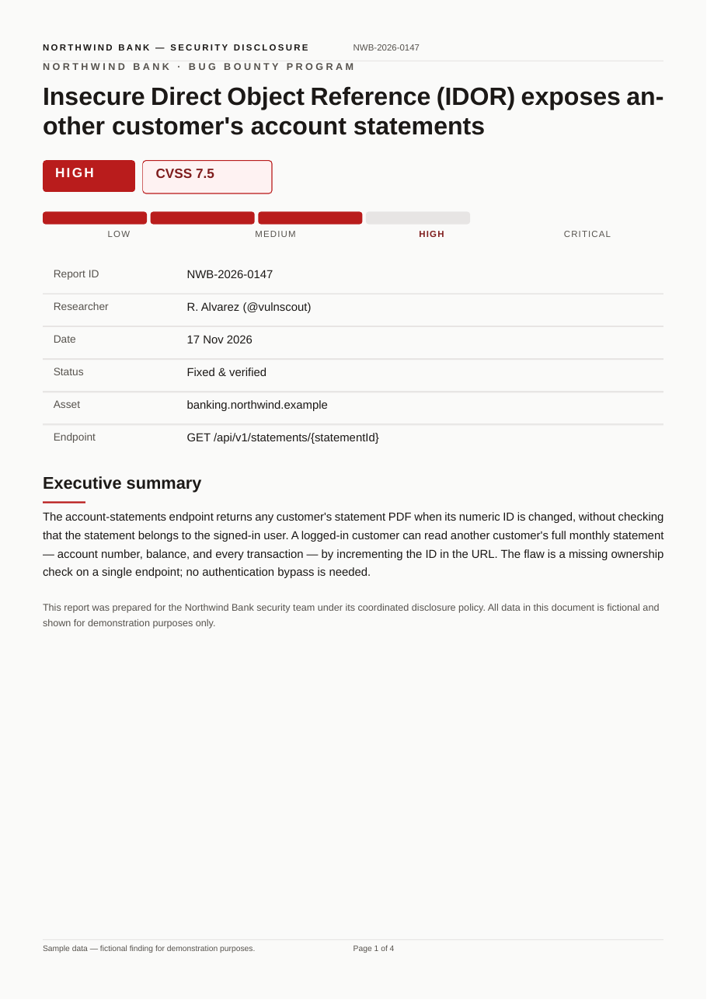
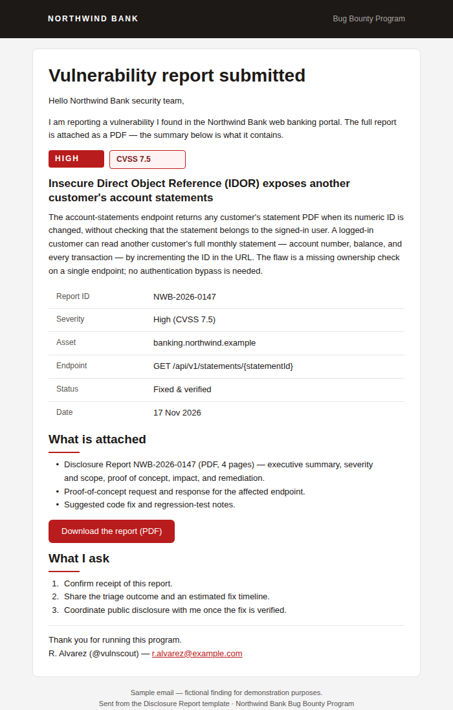
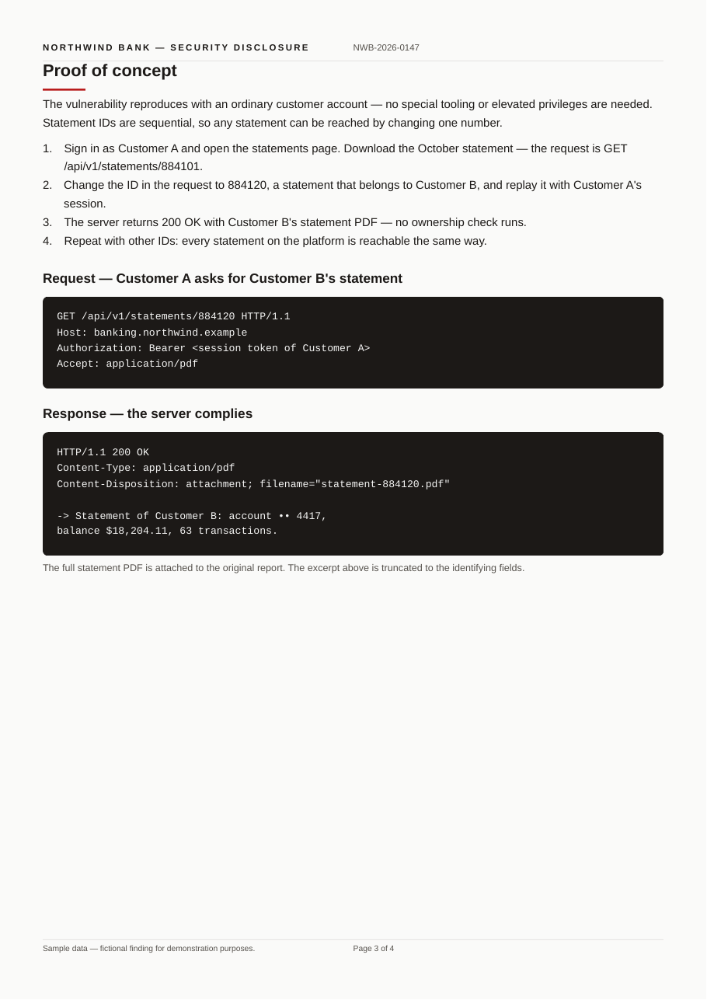

# Disclosure Report

A bug-bounty vulnerability report kit, built with [Hyper Elements](https://hyperelements.dev) for the [Hyper Elements Template Challenge](https://github.com/hyper-elements/hyper-elements/discussions/209) (November 2026).

One data file drives **two outputs**: a print-ready multi-page **PDF report** and the **delivery email** that carries it to the program's security team — same theme, same components, same facts, always in agreement.

> **Sample data is fictional.** The program (Northwind Bank), the researcher (R. Alvarez / @vulnscout), the vulnerability (an IDOR in account statements), and every detail in the report are invented for this template. Nothing here refers to a real program or a real finding.

## What it looks like

### The PDF report — cover



A 4-page A4 report: cover with severity badge + severity meter, severity & scope, proof of concept, impact & remediation. Header and footer (with page numbers) on every page.

### The delivery email



The email the researcher sends with the report attached: finding summary, severity, what's attached, and what is asked of the program — with a plain-text twin generated from the same template.

### Proof of concept (PDF, page 3)



Numbered reproduction steps plus the request/response as dark code blocks.

## How Hyper Elements is used

- **Two roots, one source of truth.** `src/report.tsx` renders a `<Document>` (A4, `renderPdf()`), `src/email.tsx` renders an `<Email>` (`render()` → HTML + plain-text twin). Both read the same finding from `src/data.ts` and share the theme and components in `src/theme.ts` / `src/components.tsx` — change the finding once, both outputs update.
- **Theme.** `defineTheme()` holds the whole brand: warm paper + ink palette, one red accent reserved for severity, Helvetica/Arial type, a `card` style and a `code` style. `token("colors.severity")` keeps the red consistent across roots.
- **Document-only elements.** The cover's severity meter is drawn with `<Svg>` (`Rect` shapes — not available in email), the footer uses `<PageNumber />` / `<PageNumber total />`, and pages are explicit `<Document.Page>` blocks with a `<PageHeader>` and `<PageFooter>`.
- **Email that survives inboxes.** Mobile styles (`style={{ mobile: … }}`), no raw HTML, and the build runs the `@hyper-elements/email-clients` plugin in `validate()` plus `renderInEmailClients()`, which produced per-client previews in `out/clients/` (Gmail, Outlook, Apple Mail — 7 previews). The email renders identically in Gmail desktop, verified with the emulator.
- **Validation as a build gate.** `scripts/build.tsx` runs `validate()` on both templates and exits non-zero on any error; the CLI check (`npm run check`) reports **0 errors, 0 warnings**. `outline()` output is printed for a layout sanity check.
- **Real fonts for the PDF.** `renderPdf()` loads no fonts itself, and the standard PDF fonts measure text slightly differently from how they draw it. The build passes vendored Liberation Sans/Mono files (`fonts/`, SIL OFL) registered as Helvetica/Courier, so layout measures exactly what the PDF draws.
- **A layout quirk, documented.** Hyper Elements' `List` lays its items out as if the marker column cost no width, so a full line renders ~24px past the right edge in the PDF and loses its last characters. `ReportList` (in `src/components.tsx`) compensates by narrowing the list — see the comment there.

## Project layout

```
src/
  data.ts         fictional finding (program, severity, CVSS, timeline, PoC, fix)
  theme.ts        defineTheme() — palette, type, card/code styles
  components.tsx  SeverityBadge, SeverityMeter inputs, SectionTitle, MetaTable,
                  CodeBlock, ReportList — shared by both roots
  report.tsx      <Document> — 4-page PDF report
  email.tsx       <Email> — delivery notification email
scripts/
  build.tsx       validate gate + renderPdf/render + email-client previews
  fonts.ts        loads the vendored Liberation fonts for renderPdf()
  screenshot.ts   Playwright screenshots of the email for this README
fonts/            Liberation Sans/Mono (SIL OFL) for the PDF build
assets/           screenshots (PDF pages + email) used in this README
out/              generated outputs (gitignored): PDF, HTML, text, client previews
```

## Run it

```bash
npm install
npm run build     # validate both templates, render the PDF + email + client previews
```

Outputs land in `out/`:

- `disclosure-report.pdf` — the 4-page report (A4)
- `disclosure-report.html` — print HTML of the same report
- `disclosure-email.html` — the email (send as-is, head styles included)
- `disclosure-email.txt` — plain-text twin, generated from the same template
- `clients/` — one HTML preview per email client (Gmail, Outlook, Apple Mail…)

Other commands:

```bash
npm run check    # npx hyper-elements check — validate + lint both templates
npm run shots    # Playwright screenshots of the email into assets/
```

Requires Node 18+. No network calls at render time; nothing is sent anywhere.

## Customize it

Edit `src/data.ts` — program, finding, severity, CVSS, timeline, PoC steps, remediation — and rebuild. The PDF and the email follow automatically. To re-skin it, edit the palette in `src/theme.ts`.

## License

MIT. Fonts in `fonts/` are Liberation Fonts, licensed under the SIL Open Font License 1.1.
